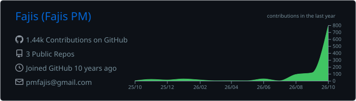

<picture>
  <source media="(prefers-color-scheme: dark)" srcset="assets/svg/header-dark.svg">
  <source media="(prefers-color-scheme: light)" srcset="assets/svg/header-light.svg">
  
</picture>

I plan, build and launch websites and apps for businesses, from the first idea to the finished product.
I keep the code simple, so it is fast and easy to change later.

[Website](https://fajis.is-a.dev) · [LinkedIn](https://www.linkedin.com/in/fajispm) · [Instagram](https://www.instagram.com/fajis.pm/) · [Email](mailto:pmfajis@gmail.com) · [CV](https://fajis.is-a.dev/cv.pdf)

### Now

- **Working** — Backend Developer at Harvard Capital Bahrain, since May 2023
- **Building** — updates to my Android apps
- **Learning** — TypeScript, Redux, DevOps
- **Open to** — freelance projects: business systems, mobile apps, integrations

### Stack

| Area | Tools | What for |
| :-- | :-- | :-- |
| Backend | Core PHP | APIs and server logic |
| Mobile | React Native | Android and iPhone apps |
| Database | MySQL | Designing tables and making queries fast |
| Frontend | JavaScript, HTML, CSS | Websites that work on any screen |

### Systems I've built

At Harvard Capital Bahrain:

- **Property management** — rental units, tenant leases, rent collection
- **Car rental** — vehicle availability, bookings, maintenance
- **Inventory** — stock levels, products, low-stock alerts
- **Gym memberships** — members, classes, payments
- **Loyalty & rewards** — points cards in Google Wallet and Apple Wallet
- **School management** — students, attendance, fees, timetables

### Apps

| App | What it does | Get it |
| :-- | :-- | :-- |
| **Stay Fit** | Track your workouts, steps and meals | [Google Play](https://play.google.com/store/apps/details?id=com.fajis.fitnessapp) |
| **Oneline** | Short notes you can search and look back on | [Google Play](https://play.google.com/store/apps/details?id=com.fajis.oneline) |
| **Calculator+** | A calculator with a currency converter and history | [Google Play](https://play.google.com/store/apps/details?id=com.fajis.SmartCalculator) |

iPhone versions are coming soon.

### Recent activity

<!--START_SECTION:activity-->
- Pushed 1 commit to [Fajis/fajis.github.io](https://github.com/Fajis/fajis.github.io)
- Created branch `claude/optimistic-bardeen-4jvtwm` in [Fajis/fajis](https://github.com/Fajis/fajis)
- Created branch `claude/beautiful-knuth-qh78xj` in [Fajis/fajis.github.io](https://github.com/Fajis/fajis.github.io)
- Merged PR [#4](https://github.com/Fajis/fajis/pull/4) in [Fajis/fajis](https://github.com/Fajis/fajis)
- Opened PR [#4](https://github.com/Fajis/fajis/pull/4) in [Fajis/fajis](https://github.com/Fajis/fajis)
<!--END_SECTION:activity-->

<picture>
  <source media="(prefers-color-scheme: dark)" srcset="profile-summary-card-output/github_dark/0-profile-details.svg">
  <source media="(prefers-color-scheme: light)" srcset="profile-summary-card-output/github/0-profile-details.svg">
  
</picture>

---

Before development I worked in sales and finance (2015–2023). MBA in Finance Management.
<!--START_SECTION:updated-->
This page updates itself every day. Last update: 30 Oct 2026.
<!--END_SECTION:updated-->

