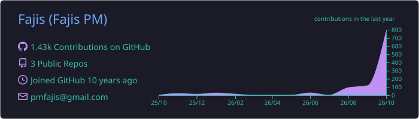
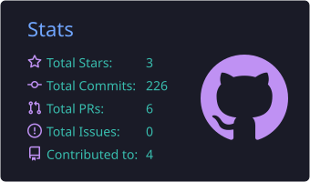
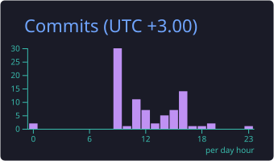
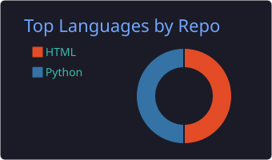
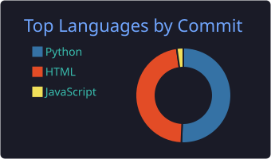

<!-- HEADER -->

  

  

  
  
  
  

  
  
  
  
  

---

##  About Me

Hi! I'm **Fajis**, a **Full-Stack Software Developer** living in **Bahrain**. I work at **Harvard Capital Bahrain**.

I build the **server side** of apps (APIs and databases) and the **mobile apps** people use on their phones. I like code that is **simple, clean and fast**, and apps that are **easy to use**.

<table>
  <tr>
    <td> <b>Focus</b></td>
    <td>Server side · Mobile apps · APIs</td>
  </tr>
  <tr>
    <td> <b>I use every day</b></td>
    <td>React Native · PHP · JavaScript · MySQL</td>
  </tr>
  <tr>
    <td> <b>Also good at</b></td>
    <td>Redux · TypeScript</td>
  </tr>
  <tr>
    <td> <b>I speak</b></td>
    <td>English · Malayalam · Hindi</td>
  </tr>
  <tr>
    <td> <b>On GitHub since</b></td>
    <td>2016</td>
  </tr>
</table>

---

##  What I Do

<table>
  <tr>
    <td width="33%" valign="top">
      <h3 align="center"> Backend</h3>
      <ul>
        <li>Build APIs with PHP</li>
        <li>Build services with Node.js</li>
        <li>Design fast databases (MySQL, MongoDB)</li>
        <li>Speed things up with Redis</li>
        <li>Keep logins and data safe</li>
      </ul>
    </td>
    <td width="33%" valign="top">
      <h3 align="center"> Mobile</h3>
      <ul>
        <li>One app for Android &amp; iOS (React Native)</li>
        <li>Manage app data with Redux</li>
        <li>Fewer bugs with TypeScript</li>
        <li>Make apps fast and smooth</li>
        <li>Publish to Play Store &amp; App Store</li>
      </ul>
    </td>
    <td width="33%" valign="top">
      <h3 align="center"> Web &amp; Servers</h3>
      <ul>
        <li>Websites that work on any screen (React)</li>
        <li>Live features like chat</li>
        <li>Run apps with Docker</li>
        <li>Set up and manage Linux servers</li>
        <li>Work in teams with Git</li>
      </ul>
    </td>
  </tr>
</table>

---

##  Tech Stack

<table align="center">
  <tr>
    <td align="center" width="160"><b>Languages</b></td>
    <td></td>
  </tr>
  <tr>
    <td align="center"><b>Frameworks</b></td>
    <td></td>
  </tr>
  <tr>
    <td align="center"><b>Databases</b></td>
    <td></td>
  </tr>
  <tr>
    <td align="center"><b>DevOps &amp; Tools</b></td>
    <td></td>
  </tr>
</table>

---

##  Featured Work

<table>
  <tr>
    <td width="33%" align="center" valign="top">
      <h3> Portfolio</h3>
      
My personal website. See my work and contact me.

      
    </td>
    <td width="33%" align="center" valign="top">
      <h3> Talk4Fun</h3>
      
A live chat website. Talk with people in real time.

      
    </td>
    <td width="33%" align="center" valign="top">
      <h3> XCode Platform</h3>
      
My SaaS business. I offer my services online here.

      
    </td>
  </tr>
</table>

---

##  How I Work

-  **Do it right** — code that is easy to read and easy to change
-  **Make it fast** — quick APIs and smooth mobile apps
-  **Keep it safe** — protect user data and logins
-  **Work as a team** — talk clearly and help others
-  **Keep learning** — always trying new tools and ideas

---

##  Recent Activity

<!--START_SECTION:activity-->
1.  Merged PR [#2](https://github.com/Fajis/fajis/pull/2) in [Fajis/fajis](https://github.com/Fajis/fajis)
2.  Opened PR [#2](https://github.com/Fajis/fajis/pull/2) in [Fajis/fajis](https://github.com/Fajis/fajis)
3.  Merged PR [#1](https://github.com/Fajis/fajis/pull/1) in [Fajis/fajis](https://github.com/Fajis/fajis)
4.  Opened PR [#1](https://github.com/Fajis/fajis/pull/1) in [Fajis/fajis](https://github.com/Fajis/fajis)
5.  Merged PR [#1](https://github.com/Fajis/fajis.github.io/pull/1) in [Fajis/fajis.github.io](https://github.com/Fajis/fajis.github.io)
6.  Merged PR [#2](https://github.com/Fajis/fajis.github.io/pull/2) in [Fajis/fajis.github.io](https://github.com/Fajis/fajis.github.io)
<!--END_SECTION:activity-->

##  Latest Repositories

<!--START_SECTION:repos-->
| Repository | Description | Language | Stars | Last push |
| :-- | :-- | :-: | :-: | :-: |
| [fajis.github.io](https://github.com/Fajis/fajis.github.io) | — | HTML | 1 | 2026-10-28 |
| [res-box](https://github.com/Fajis/res-box) | — | — | 1 | 2025-11-16 |
<!--END_SECTION:repos-->

---

##  GitHub Analytics

  

  
  

  
  

  

  <picture>
    <source media="(prefers-color-scheme: dark)" srcset="assets/svg/github-dark.svg">
    <source media="(prefers-color-scheme: light)" srcset="assets/svg/github-light.svg">
    
  </picture>

---

##  Let's Connect

  Want to work together or just say hi? I'd love to hear from you. 
  Reach me by <a href="mailto:pmfajis@gmail.com"><b>email</b></a> or on <a href="https://linkedin.com/in/fajispm"><b>LinkedIn</b></a>.

  <i>“Programming isn’t about what you know; it’s about what you can figure out.”</i>

<!--START_SECTION:updated-->

 This profile updates itself daily · Last refreshed: 28 Oct 2026, 21:01 UTC

<!--END_SECTION:updated-->

<!-- FOOTER -->

  

